# User Guide
# ユーザーガイド

<!-- TOC -->
* ユーザーガイド　[User Guide](#user-guide)
* 概要　[Overview](#overview)
  * ポータブルモード　[Portable mode](#portable-mode)
  * ツールバー　[The ToolBar](#the-toolbar)
* 詳細情報　[Detailed info](#detailed-info)
    * プレイリスト　[Playlist](#playlist)
      * DJ サブパネル　[DJ sub-panel](#dj-sub-panel)
      * プレビュー - キューダイアログ　[Preview - Cue dialog](#preview-cue-dialog)
      * 検索　[Find](#find)
      * ビジュアライザー　[Visualizer](#visualizer)
    * トランスポート　[Transport](#transport)
    * コンパクトビュー　[Compact View](#compact-view)
    * ライブラリコレクション　[Library Collections](#library-collections)
    * ライブラリトラック　[Library Tracks](#library-tracks)
    * 変換ダイアログ　[Convert dialog](#convert-dialog)
    * メタデータ編集　[Edit Metadata](#edit-metadata)
    * 複数メタデータ編集　[Multi Edit Metadata](#multi-edit-metadata)
    * フィルター　[Filter](#filter)
      * ライブラリコレクションのフィルター　[Filter Library Collections](#filter-library-collections)
      * ライブラリトラックのフィルター　[Filter Library Tracks](#filter-library-tracks)
    * ライブラリフォルダーウィンドウ　[Library Folders window](#library-folders-window)
    * 設定　[Preferences](#preferences)
      * 全般　[General](#general)
      * 表示　[View](#view)
      * YouTube 設定　[YouTube Settings](#youtube-settings)
      * パス　[Paths](#paths)
      * 詳細設定　[Advanced](#advanced)
    * KataLib について　[About](#about)
    * トラックの分割/切り捨て　[Split-Truncate Track](#split-truncate-track)
    * 名前の変更　[Rename](#rename)
    * ロスレス編集　[Lossless Edit](#lossless-edit)
    * ドロップゾーン　[DropZone](#dropzone)
    * ビジュアライゼーションビデオ設定　[Visualization Video Setup](#visualization-video-setup)
  * コンテキストメニュー　[Context Menus](#context-menus)
    * プレイリストトラック　[Playlist Track](#playlist-track)
    * ライブラリトラック　[Library Track](#library-track)
    * ライブラリコレクション　[Library Collection](#library-collection)
    * プレイリストメニュー　[Playlist menu](#playlist-menu)
    * カバーメニュー　[Cover menu](#cover-menu)
    * ビジュアライゼーションメニュー　[Visualization menu](#visualization-menu)
    * コンパクトビューメニュー　[Compact View menu](#compact-view-menu)
    * ドロップゾーンメニュー　[DropZone menu](#dropzone-menu)
* ショートカット　[Shortcuts](#shortcuts)
<!-- TOC -->

___

[The User Guide in English.](index.md)  
[Οδηγίες Χρήσης στα Ελληνικά.](index_el.md) 

#### Overview
## 概要

**[KataLib](https://github.com/noembryo/KataLib)** は、音楽 (またはビデオ)ファイルを再生、変換、整理できるWindowsプログラムです。

これは、アプリケーションのすべてのパネルが有効になったレイアウトです。

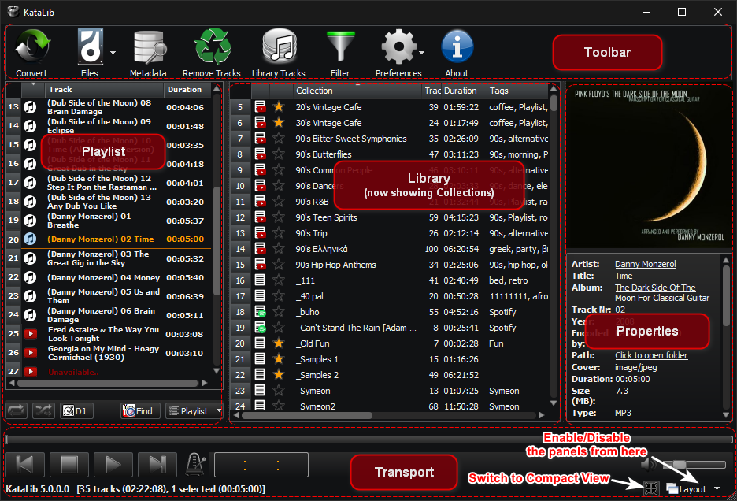

ユーザーインターフェースは、**[ツールバー](#the-toolbar)**、**[トランスポート](#transport)**、および 3つのパネル (**[プレイリスト](#playlist)**、**[ライブラリ](#library-collections)**、**プロパティ**)で構成されています。
- **[プレイリスト](#playlist)** パネルは、再生、変換、またはメタデータ編集のために、ローカルメディアファイルや YouTube リンクをドロップまたは追加できる場所です。
- **ライブラリ** パネルには2つのビューがあります：
  - [ライブラリコレクション](#library-collections) – ローカルファイルや YouTube リンクからなる仮想的なコレクションです。
  - [ライブラリトラック](#library-tracks) – ライブラリに追加したフォルダー内のメディアファイルです。
- **プロパティ** パネルには、プレイリストまたはライブラリから選択されたトラックのメタデータが表示されます。
  ライブラリコレクションが表示されていてコレクションが選択されている場合、**プロパティ**パネルには代わりにコレクションのトラックが表示されます。

パネルは、メインウィンドウの右下にある**レイアウト**メニューからオン/オフを切り替えられます。

プログラムウィンドウのサイズ、位置、設定は「レイアウト」として保存でき、**レイアウト**メニューの**ユーザーレイアウト**サブメニュー、または**設定**ツールバーボタンのメニューから簡単に再適用できます。

アプリには別のビューである[**コンパクトビュー**](#compact-view)もあります...
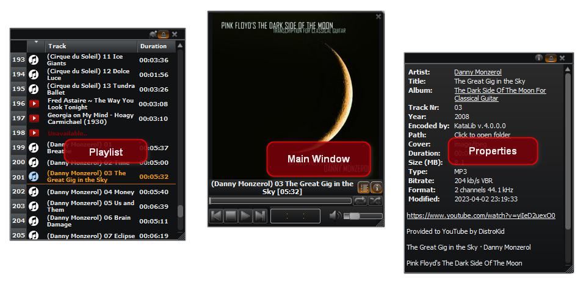
...これはメインのプレイヤーウィンドウと、**プレイリスト**および**プロパティ**の独立したウィンドウのみで構成され、画面スペースを節約するために移動したりオン/オフを切り替えたりできます。

KataLib を使用する際は、ほとんどすべてのユーザーインターフェースコントロールやボタンにツールチップがあり、その機能を簡潔に説明していることを覚えておいてください。
このツールチップは、対応するコントロールにマウスをホバーすると表示されます。

___

一般的に、KataLib は 1つで 3つのプログラムと見ることができます：
プレイヤー、コンバーター、ライブラリアンです。

- **プレイヤー**

    プレイヤーとして、ライブラリやファイルエクスプローラーからドロップした音楽やビデオファイルを再生できます。Winamp プレイリストを読み込んだり、YouTube リンクやプレイリストをダウンロードして再生することもできます。
    1つまたは複数のトラックを選択すると、メタデータの編集、コピー、移動、変換、さらにはビデオファイル自体のダウンロード (YouTubeリンクトラックの場合)など、多くのことができます。

- **コンバーター**

    コンバーターとして、[変換] を行うことができます(#convert-dialog)
    以下の種類の音声ファイルから...

    - ".mp3" - MPEG Audio Stream, Layer III (非可逆)
    - ".aac" - Advanced Audio Coding (非可逆)
    - ".m4a" - MPEG-4 Part 14 (音声のみ) AAC (非可逆) または ALAC (可逆) ストリームを含む
    - ".ape" - Monkey's Audio (可逆)
    - ".ogg" - Ogg/Vorbis (非可逆)
    - ".oga" - Ogg/Opus Audio (非可逆)
    - ".opus" - Opus Interactive Audio Codec (非可逆)
    - ".flac" - Free Lossless Audio Codec (可逆)
    - ".ac3" - Dolby AC-3 (非可逆)
    - ".wma" - Windows Media Audio (非可逆)
    - ".wav" - Waveform Audio (可逆)
    - ".aif" - Audio Interchange File Format (可逆)
    - ".mp4" - MPEG-4 Part 14 マルチメディア (aac音声ストリームを抽出)
    - ".mkv" - Matroska Multimedia Container (音声ストリームを抽出)
    - ".avi" - Audio Video Interleaved Container (音声ストリームを抽出)
    - ".mov" - QuickTime File Format (aac音声ストリームを抽出)
    - ".flv" - Flash video (aac音声ストリームを抽出)
    - ".wv" - WavPack (可逆)
    - ".mpc" - Musepack AKA MPEGplus (非可逆)
    - ".mp2" - MPEG-1 Audio Layer II (音声のみ) (非可逆)
    - ".mpga" - MPEG-1 Audio Layer III (音声のみ) (非可逆)
    - ".mpeg" - MPEG-1/2 (MPEG-1 Audio Layer II音声ストリームを抽出) (非可逆)
    - ".webm" - WebM - OggまたはOpusを含む (非可逆)
    - ".dts" - DTS - Digital Theater Systems
    - ".m4b" - MPEG-4 Part 14 (音声のみ) (非可逆) オーディオブック用
    - ".dfs" - Direct Stream Digitalファイル (可逆) (変換のみ)

    ...以下の種類の音声ファイルに変換できます。

    - ".mp3" - MPEG Audio Stream, Layer III (非可逆)
    - ".m4a" - MPEG-4 Part 14 (音声のみ) AAC (非可逆) ストリームを含む
    - ".aac" - Advanced Audio Coding AAC (非可逆)
    - ".ogg" - Ogg/Vorbis (非可逆)
    - ".opus" - Opus Interactive Audio Codec (非可逆)
    - ".flac" - Free Lossless Audio Codec (可逆)
    - ".wav" - Waveform Audio (可逆)

- **ライブラリ**

    ライブラリとして、データベースを使用して 2つの異なるタイプのデータを保存および表示します。
  - [ライブラリコレクション](#library-collections) 
     ローカルメディアファイルや YouTube リンクの仮想的なプレイリストです。
  - [ライブラリトラック](#library-tracks) 
    ローカルメディアファイル (トラック)のプロパティです。

___

#### Portable mode
## ポータブルモード

KataLib は、ショートカットに "-p" 引数を追加するか、`KataLib Portable.exe` を実行することで**ポータブル**モードで起動することもできます。
ポータブルモードでは、アプリは Windows の現在のユーザー設定からではなく、自身のフォルダー内の `portable_settings` ディレクトリから設定やデータベースなどを読み取ります。
アプリが `Program files` ディレクトリ内にインストールされている状態でポータブルモードを使用することは、Windows がこのフォルダーを特別に扱うため推奨されません。
ユーザーが書き込み可能であれば、他のディレクトリやリムーバブルドライブは問題ありません。

___

#### The ToolBar
## ツールバー

ツールバーはメインウィンドウの上部にあります。さまざまなアクションを実行するためのボタンが含まれています。
これらのボタンは、現在フォーカスされているアプリのパネルに応じて変更されたり無効化されたりします。
ツールバーの空きスペースを右クリックすると、このメニューが表示されます...

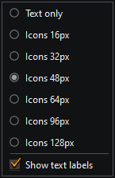

...これによりツールバーアイコンのサイズと外観を変更できます。

常に表示されているボタンは次のとおりです：

  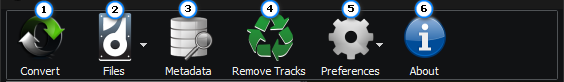

1. **変換**
    選択したトラックの変換方法を設定するための[変換ダイアログ](#convert-dialog)を開きます。
2. **ファイル**
    以下のファイル管理オプションを含むメニューを表示します：
      - 選択したファイルを新しい場所に**コピー** (ファイル選択ダイアログを使用)
      - 選択したファイルを新しい場所に**移動** (ファイル選択ダイアログを使用)
      - パターンを使用して選択したファイルを[**名前の変更**](#rename)
      - 選択したファイルをディスクから**削除**。<ins>_**注意して使用してください！**_</ins>
3. **メタデータ**
    選択したトラックの数に応じて、[メタデータ編集](#edit-metadata) (単一選択)または[複数メタデータ編集](#multi-edit-metadata) (複数選択)ダイアログを開きます。
4. **トラック削除 / ファイル削除 / コレクション削除**
    このボタンは、現在フォーカスされているパネルに応じて外観と機能が変わります。
    プレイリストにフォーカスがある場合、選択したトラックをプレイリストから削除します。
    ライブラリコレクションパネルにフォーカスがある場合、選択したコレクションをライブラリデータベースから削除します。
    ライブラリトラックパネルが選択されている場合、選択したファイルをライブラリから削除し、<ins>_**ディスクからも削除します！**_</ins>
5. **設定**
    [設定](#preferences)ダイアログを開きます。
    ボタンの横の矢印をクリックすると、保存されたレイアウトとその管理オプションを含むドロップダウンメニューが開きます：
      - 現在のレイアウトを新しいレイアウトとして**追加**
      - 現在選択されているレイアウトを**更新**
      - 現在選択されているレイアウトを**削除**

   メニューには[コンパクトビュー](#compact-view)に切り替えるオプションも含まれています。
6. **このアプリについて**
    プログラムに関する情報などを含む[このアプリについて](#about)ダイアログを表示します。

ライブラリパネルが表示されフォーカスされており、ライブラリコレクションが表示されている場合、以下のボタンが表示されます：

  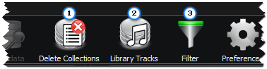

1. **コレクション削除** (プレイリストパネルにフォーカスがある場合は**トラック削除**)
    選択したコレクションをライブラリから削除します。
2. **ライブラリトラック**
    ライブラリコレクションの代わりにライブラリファイルを表示します。
3. **フィルター**
    [ライブラリコレクションのフィルター](#filter-library-collections)ダイアログを開きます。

ライブラリパネルが表示されフォーカスされており、ライブラリトラックが表示されている場合、以下のボタンも表示されます：

  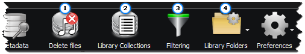

1. **ファイル削除**
    選択したファイルをライブラリから削除し、_**<ins>ディスクからも削除します！</ins>**_
2. **ライブラリコレクション**
    ライブラリファイルの代わりにライブラリコレクションを表示するように切り替えます。
3. **フィルター**
    [ライブラリトラックのフィルター](#filter-library-tracks)ダイアログを開きます。
4. **ライブラリフォルダー**
    [ライブラリフォルダー](#library-folders-window)管理ウィンドウを表示します。
    ボタンの横の矢印をクリックするとドロップダウンメニューが表示されます。
    この**ライブラリフォルダーメニュー**には、**フォルダー追加**および**フォルダー再スキャン**ボタンのショートカットがあります。

#### Detailed info
## 詳細情報

#### Playlist
## プレイリスト

プレイリストパネルはプレイヤーの主要部分です。
ここに音声ファイルやプレイリストをドラッグしたり、**検索**ボタンを使用して YouTube やコレクションからトラックを検索したりできます。
読み込まれたトラックは、再生、さまざまな形式への変換、プレイリストとしての保存などに使用できます。

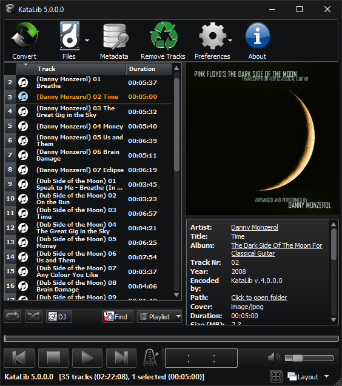

プレイリストの下にあるボタンは次のとおりです：

- **繰り返し** - 最後のトラックが再生終了したときにプレイヤーが最初から再生を開始します。
- **シャッフル** - プレイヤーをランダムな順序で再生します。
- **DJ** - 再生中のトラックを次のトラックとクロスフェードできる[DJ サブパネル](#dj-sub-panel)を開きます。
- **検索** - プレイリスト、YouTube、またはライブラリコレクション内のトラックを検索するための[トラック検索](#find)ダイアログを開きます。
- **プレイリスト** - [プレイリストメニュー](#playlist-menu)を開きます。

#### DJ sub-panel
## DJ サブパネル

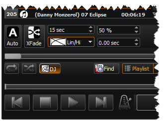

DJ コントロールは次のとおりです：
- **自動**
  有効な場合、現在再生中のトラックの残り時間が**継続時間**と等しくなると、次のトラックのクロスフェードを自動的に開始します。
- **クロスフェード**
  これを押すと即座にクロスフェードが開始されます。
- **継続時間**
  クロスフェードの継続時間 (秒)。
- **タイプ**
  フェードイン/アウトのカーブをここで選択します。
- **レベルオフセット**
  これは次のトラックの開始レベルのパーセンテージです。トラックはこのレベルから 100%の再生レベルまでフェードインします。
- **位置オフセット**
  ここで次のトラックの開始位置を選択できます。
- **プレビュー**
  次のトラックをプレビュー/試聴するための[プレビュー - キュー](#preview---cue-dialog)ダイアログを開きます。
- **クロスフェーダー**
  手動でクロスフェードを実行します。
  このスライダーを動かすと、再生中のトラック (スライダーを右に動かすほど音量が下がる)と次のトラック (スライダーを右に動かすほど音量が上がる)の両方の音量が同時に変化します。
  一番右まで行くとクロスフェードが終了し、スライダーは初期位置に戻ります。

#### Preview - Cue dialog
## プレビュー - キューダイアログ

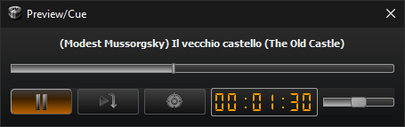

このダイアログでは、クロスフェードを行う前に次のトラックをプレビュー/試聴できます。
これはトラックを再生するものとは異なるプレイヤーであるため、一時停止、停止などが可能です。
プレイリストまたはライブラリから選択した任意のトラックを再生します。
その出力は[設定](#preferences)でメインプレイヤーの出力とは異なるように設定できるため、ヘッドフォンや別のオーディオシステムを使用してトラックをプレビューできます。

コントロールは次のとおりです：

- トラックの**スライダー**でトラック内をシークできます。
  クリックせずにマウスを合わせると、特定のスライダー位置での経過時間と残り時間が表示されます。
- **再生/一時停止**ボタンでプレビューを開始/一時停止します。
- **次に設定**ボタンは、現在選択されているトラックを再生中のトラックの次に移動し、クロスフェードおよび/または**マーク**の準備を整えます (ライブラリからファイルを再生中は機能しません)。
- **マークオフセット**ボタンは、再生中のトラックとクロスフェードされるトラックの開始[位置オフセット](#dj-sub-panel)を設定します (再生中の次のトラックが選択されている場合のみ機能します)。
- **時間表示**は経過時間と残り時間を切り替えられます。
- **音量**スライダーはプレビューの音声レベルを制御します。

#### Find
## 検索

**検索**ボタンを押すと**トラック検索**ダイアログが開き、以下の場所でトラックを検索できます。

- **YouTube**

  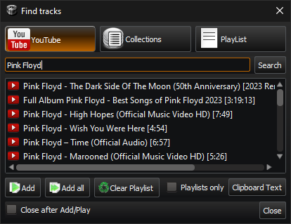
  **YouTube** で曲を検索し、見つかったら**追加**してプレイリストに追加できます。プレイリストにドロップすることも同様に機能します。
  クリアプレイリストボタンは、新しく見つけたトラックを追加する前に、プレイリストからすべてのトラックを削除するために使用できます。
  **プレイリストのみ**チェックボックスがオンになっている場合、YouTube 検索はプレイリストのみを返し、そのいずれかを追加すると、そのすべてのトラックがプレイリストに追加されます。
  **クリップボードテキスト**ボタンは、クリップボードに存在する YouTube アドレスを表示したり、独自のアドレスを入力したりできます。

- **コレクション**

  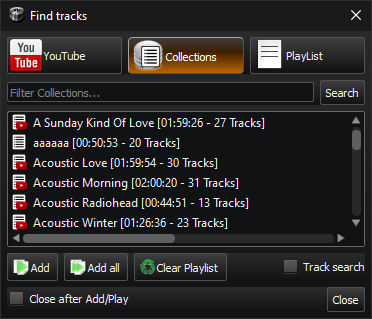

  ライブラリ内の**コレクション**を検索したり、これらのコレクション内の特定のトラックを検索したりすることもできます (**トラック検索**がオンになっている場合)。

- **プレイリスト**
  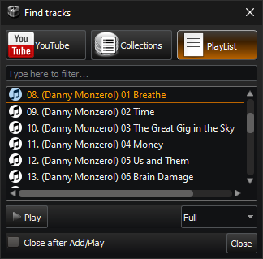

  最後に、現在読み込まれている**プレイリスト**内の特定のトラックを検索して**再生**できます。

#### Visualizer
## ビジュアライザー

ビジュアライザーは、現在再生中のトラックの音声データを可視化する方法です。
次の3つのモードのいずれかで表示できます：

* **スペクトラムアナライザー**
  デフォルトのもので、現在再生中のトラックの周波数スペクトルを表示します。
  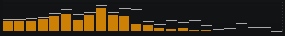
* **オシロスコープ**
  現在再生中のトラックの波形を表示します。
  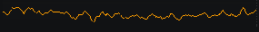
* **スペクトログラム**
  現在再生中のトラックの周波数スペクトルに加えて、時間軸も表示します。
  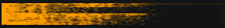
* **ピークメーター**
  現在再生中のトラックのレベルを表示します。
  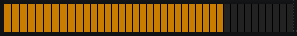

ビジュアライザーをクリックすると次のタイプに進み、右クリックすると[ビジュアライゼーションメニュー](#visualization-menu)が開きます。

#### Transport
## トランスポート

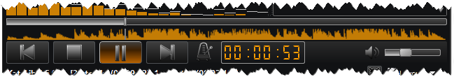

ほとんどが自明の再生コントロールです：

- **位置バー** - 現在再生中のトラックの位置を表示し、特定のポイントにジャンプできます。
- **波形** - 音声トラックの視覚的表現で、特定のポイントにジャンプすることもできます。
- **前のトラック** - 前のトラックに移動/再生します。
- **停止** - 再生を停止します。
  クリック時に `Alt` を押しながらだとフェードアウトし、`Shift` を押しながらだとトラック終了時に再生を停止し次のトラックを選択します。
- **再生/一時停止** - 再生/一時停止を切り替えます。
- **次のトラック** - 次のトラックに移動/再生します。
- **タップテンポ** - トラックのBPMを手動で測定しメタデータに追加できるタップテンポダイアログを開きます。
- **時間表示** - さまざまな時間のいずれかを表示します。右クリックで開くメニューから選択するか、左クリックで順に切り替えられます：
  - 経過時間
  - 残り時間
  - 合計経過時間
  - 合計残り時間
- **ミュート** - 音声出力をミュート/ミュート解除します。
- **音量** - 音声出力の音量を変更します。

#### Compact View
## コンパクトビュー

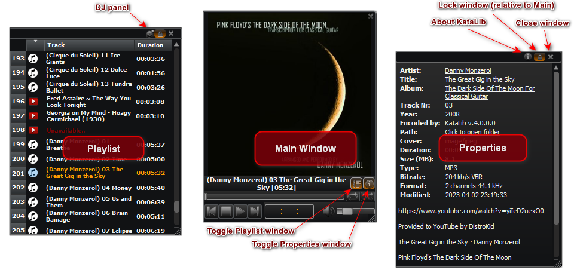

これはアプリの最小ビューで、サイズ変更可能な小さなメインウィンドウのみで構成され、主に現在再生中 (または選択中)のトラックのカバーアート、[ビジュアライザー](#visualizer)、再生を制御する[トランスポート](#transport)を表示します。

トランスポートの上には、現在選択/再生中のトラックのタイトルと、プレイリストとプロパティウィンドウを開閉する2つの追加ボタンがあります。
このタイトルテキストをダブルクリックすると、エクスプローラーでファイルが表示されるか、システムのブラウザで YouTube URL が開きます。
カバーアートをダブルクリックすると、トラックにメタデータがある場合に[メタデータ編集](#edit-metadata) (または[複数](#multi-edit-metadata))ダイアログが開きます。
カバーアートを右クリックすると、追加オプションを含む[コンテキストメニュー](#compact-view-menu)が作成されます。

すべての**コンパクトビュー**ウィンドウには、それらを閉じる**閉じる**ボタン (**x**)があります。
プレイリストとプロパティウィンドウは**フルビュー**と同じ機能を持ち、さらにいくつかのボタンがあります。
**ロック**ボタンは、メインウィンドウに対するウィンドウの位置をロックするため、メインウィンドウを移動するとロックされたウィンドウも同じように一緒に移動します。
さらに、プレイリストウィンドウにはプレイリストの[DJパネル](#dj-sub-panel)を開く**DJ** ボタンがあり、プロパティウィンドウには[このアプリについて](#about)ウィンドウを開く**このアプリについて**ボタンがあります。

#### Library Collections
## ライブラリコレクション

**ライブラリコレクション**を表示しているとき、各行はコレクションの名前、トラック数、カスタムタグ、合計再生時間などで構成されます。

コレクションには 3つのタイプがあります：
- YouTube プレイリストのアドレス URL を使用する YouTube コレクション
- Spotify プレイリスト、アルバム、またはポッドキャストリストのアドレスURLを使用できる Spotify コレクション
- 任意の数のローカル/YouTube トラックを含むことができ、アドレス URL を使用しないカスタムコレクション

お気に入りのコレクションには**スター**を付けることができ、この属性をフィルターリングやソートに使用できます。

プレイリストの右クリックメニューからコレクションを作成したり、既存のコレクションにトラックを追加したり、コレクションからトラックを削除したり、既存のコレクションを削除したり、再生のためにプレイリストにドロップしたりできます。

#### Library Tracks
## ライブラリトラック

**ライブラリトラック**を表示しているとき、各行はいくつかの基本情報 (ファイルサイズやファイルタイプなど)、一部の音楽ファイルに含まれる情報 (アーティストやタイトルなど)、そして最終的に自分で提供してコレクションの整理に役立つ情報 (タグや評価など)で構成されます。
音楽ファイルをライブラリに取り込むには、プログラムにその場所を指定する必要があります。
これは**ライブラリフォルダー**ツールバーボタンを押すことで行います。
**ライブラリフォルダー**ダイアログでは、ライブラリにフォルダーを追加/削除できます。
ライブラリに追加できるのはフォルダーのみで、個々のファイルは追加できません。
フォルダーを再スキャンして内容の変更をライブラリに更新したり、チェックまたはチェック解除して表示/非表示を切り替えたりできます。
ライブラリでファイルを選択すると、**プロパティ**パネル (表示されている場合)でそのプロパティを表示できます。
任意のセルをもう一度クリックすると、そのセルの内容を編集できます。セルの編集はライブラリの内容を変更するだけでなく、ファイル自体のメタデータも変更します。
ファイルのメタデータは、セルをクリックして直接編集するか、**メタデータ**ツールバーボタンを押すことで編集できます。
これにより**メタデータ編集**ダイアログが開きます。
ボタンを押したときに複数のファイルが選択されている場合は、**複数メタデータ編集**が開き、そこでの変更が選択したすべてのファイルに影響します。
選択したファイルは任意の場所にコピーまたは移動でき、内蔵コンバーターで他の多くの音声形式に変換することもできます。
再生もできますが、自動的に進める (リストのように)には、プレイヤーのプレイリストが空でなければなりません。

#### Convert dialog
## 変換ダイアログ

変換設定を選択するためのダイアログです。

 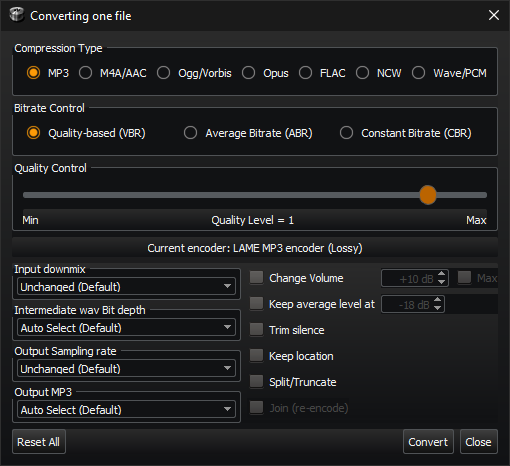

変換の通常のワークフローは、ファイルを `.wav` ファイル形式に非圧縮し、選択したエンコーダーで再エンコードすることです。

エンコーダーの主要な設定 (_圧縮タイプ_や変換の_品質制御_など)に加えて、さらにいくつかの設定があります：

- **入力ダウンミックス**
  このオプションは、マルチチャンネル音声ファイル (5.1、9.1など)をステレオまたはモノラルストリームにダウンミックスします。
- **中間 WAV のビット深度**
  これは中間 (または最終)WAVEファイルのビット深度に影響します。
- **出力サンプリングレート**
  エンコードのサンプリングレートを変更します。
- **MP3 出力**
  これは MP3 エンコードのみに影響します。チャンネルアルゴリズムを変更します。
- **音量変更**
  変換されたトラックの音量を上げたり下げたりします。
    - **最大** (`音量変更`が有効でない場合は無効)
        トラックの音量を正規化します。
        音量を最大 (クリッピング前)まで上げたり下げたりします。
- **平均レベルを維持**
  トラックの平均レベルをこの値に近づけます。
  デフォルト値は -18 です。0に近づけると平均レベルが上がります。
  <ins>_**0に近いレベルは音が歪むため使用しないでください！**_</ins>
- **無音をトリム**
  トラックの先頭と末尾の無音を削除します。
- **分割/切り捨て**
  トラックを複数のスライスに分割したり、特定の長さに切り捨てたりできる追加ダイアログを開きます。
- **位置を保持**
  変換したトラックを元のトラックと同じディレクトリに保存します (リンクはダウンロードフォルダーに保存されます)。
  <ins>_**元のファイルを変換したファイルで上書きしないように注意してください。**_</ins>
- **結合 (再エンコード)**
  選択したトラックを結合して1つの連続したトラックを作成します。
  ファイルは非圧縮、結合、再圧縮されます。
   (同じ形式の複数トラックが選択されている場合のみ有効)

**すべてリセット**ボタンはダイアログの設定をデフォルトに戻します。
**変換**は変換プロセスを開始し、**閉じる**はダイアログを閉じるだけです (ただし、加えられた変更はすべて保持されます)。

#### Edit Metadata
## メタデータ編集

  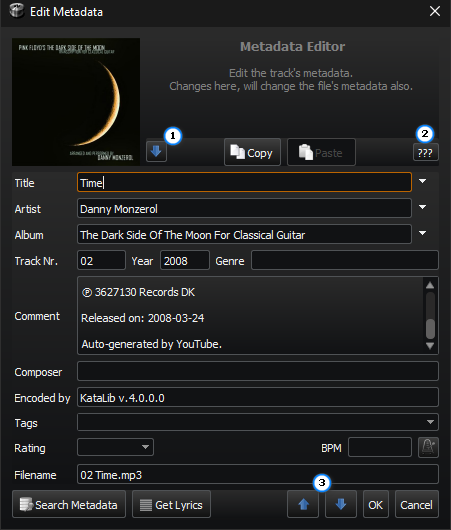

このダイアログでは、トラックのすべてのメタデータを編集し、ファイル名も変更できます。

メタデータ (カバー画像を含む)を**コピー**および**貼り付け**できます。
貼り付けを押すと、**貼り付けオプション**ダイアログが開き、コピーされたメタデータからどのフィールドを貼り付けるかを選択できます。

説明が必要な「便利」ボタンがいくつかあります。
1. このボタンは**カバーダウンロード**ダイアログを開き、自動的に検索を開始します (余分なクリックを省けます)。
2. このボタンは、既存のタグを使用してメタデータを自動検索することで欠落フィールドを推測します (タイトル、アーティスト、アルバム、トラック番号、年にのみ機能します)。
3. これらのボタンは、現在のトラックのメタデータダイアログを閉じて、次の (または前の)トラックを自動的に開きます。

少なくともトラックのタイトルを提供すれば、インターネットから**メタデータを検索**するオプションもあります。

**歌詞を取得**ボタンは、現在のトラックの歌詞を検索します。
歌詞が見つかった場合、既存のテキストの_後に_コメントに追加されます。

このダイアログで行われたすべての変更は、OK または次の/前の矢印ボタンが押されるまでファイルに書き込まれません。

#### Multi Edit Metadata
## 複数メタデータ編集

  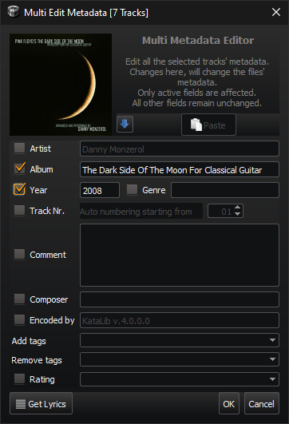

選択したすべてのファイルのメタデータを一度に変更するダイアログを開きます。
チェックされた (有効な)エントリのみがファイルに影響します。
チェックされた (有効な)エントリに値がない場合、該当するメタデータは消去されます。

便利なボタンには次のものがあります：
- **自動番号付けの開始番号**
    **トラック番号**がチェックされている場合、選択したトラックにここで設定された番号から順次新しいトラック番号が付けられます。
- **歌詞を取得**
    このボタンはここでは少し異なる動作をします。
    選択したすべてのトラックの歌詞を検索し、見つかったものは自動的に該当するメタデータに追加されます。

もちろん、OK ボタンが押されるまで実際にファイルに書き込まれることはありません。

#### Filter
## フィルター

**フィルター**機能は、ライブラリに表示される内容を絞り込むのに役立ちます。
ライブラリの表示モード (コレクションまたはトラック)に応じて、このボタンは異なるダイアログを開きます。

#### Filter Library Collections
## ライブラリコレクションのフィルター

 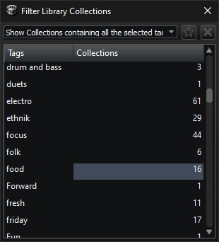

このダイアログでは、タグを使用してコレクションをフィルターリングできます。
複数のタグを選択でき、以下のオプションがあります：
- 選択したすべてのタグを含むコレクションを表示
- 選択したいずれかのタグを含むコレクションを表示
- 選択したタグを1つも含まないコレクションを表示

「星」ボタンは**お気に入り**コレクションのみでフィルターリングでき、「**x**」ボタンは選択したすべてのタグをクリアします。
各タグ名の横には、そのタグを使用するコレクションの数を示す数字もあります。

#### Filter Library Tracks
## ライブラリトラックのフィルター

 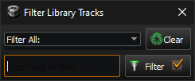    
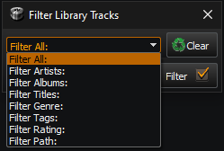

このダイアログでは、パス、メタデータ (アーティスト、アルバム、タイトル、ジャンル、タグ、評価)、または上記すべてを使用してトラックをフィルターリングできます。
**フィルター**ボタンを押すとビューが更新され、**クリア**ボタンを押すとリセットされます。
**フィルター**ボタンのチェックボックスがオンになっている場合、入力中にビューが更新されますが、ライブラリに多くのファイルが表示されている場合は遅くなる可能性があります。
キーワードとともにブール演算子 (OR、AND、NOT は大文字で)も使用できます。
例：`Pink Floyd AND Animals`
これにより、アルバム「Animals」からのすべてのPink Floydトラックが表示されます。

#### Library Folders window
## ライブラリフォルダーウィンドウ

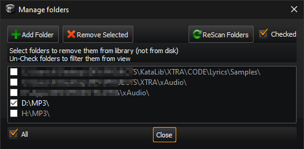

すべてのライブラリトラックを含むライブラリフォルダーを管理します。
ここでは以下のことができます：

- **フォルダー追加**は、ライブラリにフォルダーを追加するためのフォルダー選択ダイアログを開きます。
  選択したフォルダー内のすべての音楽ファイルと、その選択したフォルダーの_内側_のフォルダー内のファイルがライブラリに追加されます。
  別のフォルダーエントリのサブフォルダーでもあるフォルダーエントリは、冗長として削除されます。
  もちろん、ファイルは引き続きライブラリに残ります。
- **選択を削除**は、選択された (チェックされていない)フォルダーをライブラリから削除します (ディスクからは削除しません)。
- **フォルダー再スキャン**は、ライブラリのフォルダーを再スキャンして、メタデータが変更された場合に更新し、ライブラリフォルダーの内容が変更された場合に新しいファイルを追加したり削除されたファイルを削除したりします。
- **チェック済み** チェック済みが_チェックされている_ (！)場合、**再スキャン**ボタンが押されたときに_チェックされた_ (！！)フォルダーのみがスキャンされます。
  それ以外の場合はすべてのフォルダーがスキャンされます。
- **すべて**チェックボックスはすべてのフォルダーをチェック/チェック解除します。

フォルダーの前のチェックマークは、そのフォルダーの内容がライブラリに表示されるかどうかも決定します。
ファイルエクスプローラーからフォルダーをここにドロップしてライブラリに追加することもできます。

#### Preferences
## 設定

設定ダイアログには 5つのページがあります：

#### General
## 全般

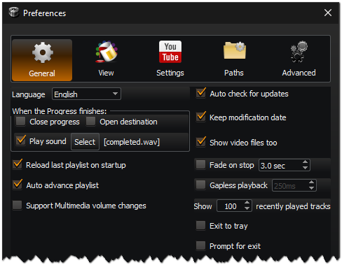

- **言語**
  プログラムの言語を選択します。
- **進捗完了時：**
  - 進捗を閉じる - 進捗ウィンドウを閉じます
  - 保存先を開く - エクスプローラーで保存先ディレクトリを開きます
  - サウンドを再生 - すべて完了したときに音を鳴らします
  - [_現在のサウンド_] を選択
    このボタンを押して ".wav" ファイルを参照することで、別の音声ファイルを選択できます。
- **起動時に最後のプレイリストを再読み込み**
  プログラム起動時に、前回終了時に読み込まれていたトラックを再読み込みします。
- **プレイリストを自動進行**
  プレイリストでトラックの再生が終了すると、次のトラックが自動的に再生を開始します。
- **開いたトラック/プレイリストを自動再生**
  ファイルまたはプレイリストがKataLibで開かれ、プレイリストが空の場合に自動的に再生を開始します。
- **マルチメディア音量変更をサポート**
  マルチメディアキーを使用してプレイヤーの再生音量を制御できるようにします。
- **出力セクション**では、プレイヤーの**メイン出力**と、[プレビュー/キュー](#preview---cue-dialog)ダイアログが使用する**ヘッドフォン出力**の音声デバイスを独立して選択できます。
- **更新を自動チェック**
  オンラインで新しいバージョンを自動チェックします。
- **更新日時を保持**
  ファイルのメタデータを編集するときに元の更新日時を保持します。
- **ビデオファイルを表示**
  ライブラリにビデオファイルを表示し、プレイリストで再生できるようにします。
  これらのファイルは常にデータベースにあり、表示するかどうかを選択するだけです。
  ビデオファイルは、avi、mp4、mov、mkvなどの拡張子を持つファイルです。
- **ギャップレス再生**
  次のトラックの読み込みに必要な時間に聞こえる無音を排除しようとします。
- **停止時にフェード**
  停止する前に再生中のトラックをフェードアウトします。
- **最近再生されたトラックを表示 […]**
  最近再生されたメニューに表示するトラック数を選択します。
- **速度**
  プレイヤーの再生速度。デフォルトは x1.00 です。
  速度が変更された場合、結果の音声はトラックの右クリックメニュー (編集した音声をエクスポート)から保存できます。
- **ピッチ**
  プレイヤーの再生ピッチ (半音単位)。デフォルトは 0.00 です。
  ピッチが変更された場合、結果の音声はトラックの右クリックメニュー (編集した音声をエクスポート)から保存できます。
- **トレイに終了**
  閉じるボタンが押されてもKataLibを終了せず、代わりにトレイアイコンに最小化します。
  これが有効な場合、プログラムを終了する唯一の方法はトレイアイコンメニューの**終了**エントリです。
- **終了の確認**
  プログラム終了前に確認ダイアログを表示します。

[//]: # (- **メイン出力**  )

[//]: # (  再生用のシステムオーディオ出力を選択します。)

[//]: # (- **フォン出力**  )

[//]: # (  モニタリング/キュー用のシステムオーディオ出力を選択します。)

#### View
## 表示

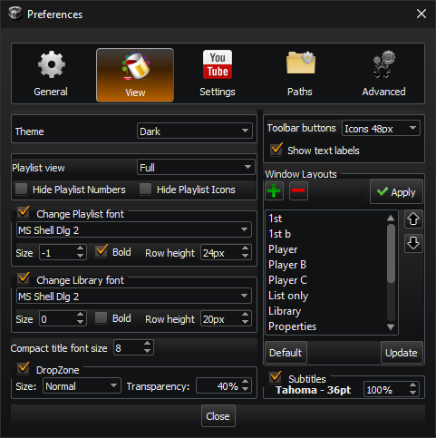   

**テーマ**
ライト、ダーク、カスタムテーマから選択します。
カスタムテーマは `.qss` (Qt風の `.css`)ファイルを受け入れます。
これらのファイルは、設定ダイアログが閉じているときにメインウィンドウにドラッグアンドドロップすることで迅速にプレビューすることもできます。

**プレイリストビュー**
プレイリストのトラック表示方法を変更します。

- **フル** -> (アーティスト) トラック番号 タイトル
- **タイトルのみ**
- **ファイル名**
- **アーティストとタイトル** -> (アーティスト) タイトル

プレイリスト番号やプレイリストアイコンを非表示にすることもできます。

**プレイリストのフォントを変更**
プレイリストエントリのフォントと行の高さを変更します。

**ライブラリのフォントを変更**
ライブラリエントリのフォントと行の高さを変更します。

**コンパクトタイトルのフォントサイズ**
**コンパクトビュー**レイアウトで表示されるトラックタイトルのフォントサイズを変更します。

**ドロップゾーン**
[ドロップゾーン](#dropzone)の使用を有効にし、その外観をカスタマイズします。

**ツールバーボタン**と**テキストラベルを表示**
ここではツールバーボタンの外観をカスタマイズできます。
ツールバーアイコンのサイズや、アイコンとテキストのどちらを表示するかを選択できます。

**ウィンドウレイアウト**
ここでウィンドウ設定 (サイズ、位置、開いているパネル、フォントなど)を保存できます。

- **+ / -**
  現在のウィンドウ設定を追加 / 現在選択されているレイアウトを削除します。
- **適用**
  現在選択されているレイアウトを適用します。
- **上/下矢印**
  現在選択されているレイアウトを移動します。
- **更新**
  選択したレイアウトを現在のウィンドウ設定で更新します。
- **リセット**
  現在のウィンドウ設定をデフォルトにリセットします。

**字幕**
字幕テキストのフォントと位置を変更できます (字幕付きのビデオファイル用)。

#### YouTube Settings
## YouTube 設定

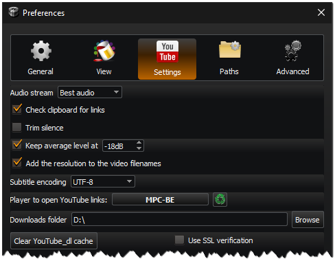

- **音声ストリーム**
  変換に使用される YouTube の音声ストリームです。
- **クリップボードのリンクをチェック**
  クリップボードに YouTube のビデオまたはプレイリストのアドレスを含むテキストがあるかチェックします。
- **無音をトリム**
  トラックの先頭と末尾の無音をトリムします。
- **平均レベルを維持**
  YouTube トラックの平均再生レベルをこの値に近づけます。
  デフォルト値は -18 です。0に近づけると平均レベルが上がります。
  <ins>0に近いレベルは音が歪むため使用しないでください！</ins>
- YouTube からビデオを保存するときに**ビデオファイル名に解像度番号を追加**します。
- **字幕エンコーディング**
  保存される字幕ファイルに使用されるエンコーディング (UTF-8/ANSI)です。
- **YouTube リンクを開くプレイヤー**
  YouTube リンクを処理するために使用するプレイヤーを選択します (VLC や Media Player Classicなど)。
- **ダウンロードフォルダー**
  YouTube からのファイルがダウンロードされるディレクトリです。
- **SSL 検証を使用**
  YouTube トラックの情報取得に問題がある場合はこれを無効にしてください。

#### Paths
## パス

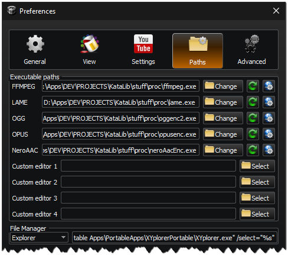

ここでは、アプリが使用する実行ファイルへのパスを選択します：
- 音声ファイルの変換 (FFMPEG、LAME、OGG、OPUS、NeroAACなど)
- トラックの外部編集 (4つの異なる選択肢)
- ファイルリンクを処理するファイルマネージャー (デフォルトのWindowsエクスプローラーでない場合)

#### Advanced
## 詳細設定

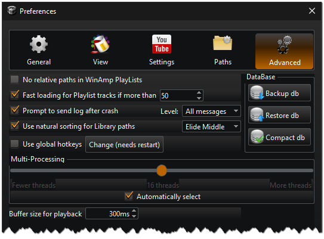

**プレイリストで相対パスを使用しない**
プレイリストは絶対パスと相対パスの両方を持つことができます。
相対パスは、プレイリストの位置が元の保存時と同じくファイルの位置と同じ関係にある場合にのみ機能します。
両方が移動されても位置関係が保たれていれば、プレイリストは機能します。
プレイリストのみを移動しファイルを移動しない場合は、すべてのパスが絶対パスである必要があります。

**プレイリストトラックの高速ロード (この数以上の場合)**
基本プロパティを使用してトラックを高速ロードし、可能な場合は残りの情報を取得します。

**クラッシュ後にログ送信を促す**
プログラムがクラッシュした場合、デバッグのためにクラッシュログを開発者に送信するかどうかを尋ねます。

**ライブラリパスに自然順ソートを使用**
通常の (アルファベット順)ソートでは「Track 2」の前に「Track 11」が来ますが、約15%高速です。
自然順ソートは、パス内の数字を期待通りにソートします (例：X1、X2、X11)。

**グローバルホットキーを使用**
KataLib のウィンドウがバックグラウンドにあるときも再生を制御します。
**変更**ボタンを押すと、どのキーボード組み合わせがどのアクションを行うかを選択できるダイアログが開きます。
デフォルト設定については、最後の[ショートカット](#shortcuts)セクションを参照してください。

**データベース**

- **DB をバックアップ**
  安全のためデータベースファイルをバックアップします。
- **DB を復元**
  バックアップからデータベースを復元します。
- **DB を最適化**
  データベースファイルを最適化して容量を節約します。

**マルチプロセッシング**

- **スレッド**
  プログラムが複数タスクの並列処理に使用するスレッド (またはコア)数です。
- **自動選択**
  プログラムはプロセッサの物理コア数に基づいてスレッド数を選択します。

#### About
## KataLib について

5つのページで構成されるプログラムに関する情報です：

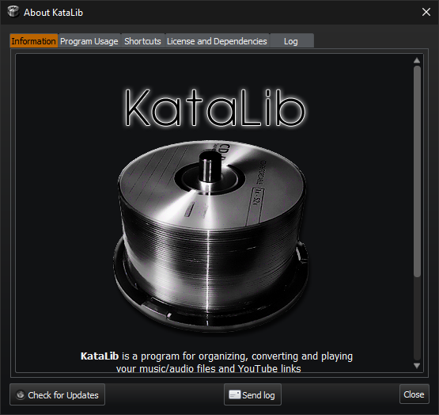

- KataLib に関する情報。
- ユーザーガイド。
- KataLib のショートカットの簡単な概要。
- プログラムが使用するライブラリとそのライセンス。
- アプリケーション実行中にさまざまなデバッグ情報を出力するログビュー。

___

#### Split-Truncate Track
## トラックの分割/切り捨て

このダイアログでは、選択したトラックの開始または終了を切り捨てるか、複数の異なるトラックに分割するかを選択できます。
番号付きフィールドを使用してこれを行い、**プレビュー**ボタンで変更結果を試聴できます。

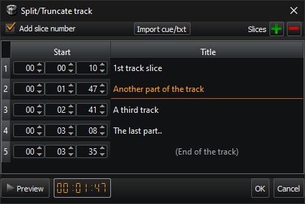

このダイアログを最初に開くと、開始時間 (トラックの開始でもあります)を持つ1つのスライスと、2番目の時間として (**トラックの終わり**)の時間が含まれています。
これらのデフォルト値は、開始が 00:00:00、終了がトラックの再生時間です。
これらを変更すると、トラックの開始/終了が切り捨てられます。

**プラス (+)**ボタンを押すとトラックの新しいスライスを追加でき、**マイナス (-)**ボタンは選択したスライスを削除します。
任意のスライスの**タイトル**列をダブルクリックすると、そのスライスのタイトルを変更でき、結果として得られるトラックのタイトル/ファイル名も変更されます。
すべてのスライスの**開始**フィールドは編集可能で、**プレビュー**ボタンを使用して変更をプレビューできます。

結果として得られるすべてのトラックは、タイトルとトラック番号を除き、元のトラックのメタデータのコピーを持ちます。
タイトルはスライスのタイトルになり、**スライス番号を追加**チェックボックスがオンになっている場合、スライス番号がメタデータのトラック番号になります。

**cue/txt をインポート**ボタンは、*.cue または *.txt ファイルからオフセット時間をインポートできます。
`*.cue` 形式は標準ですが、`*.txt` ファイルの形式は次のとおりです：

* 1行に1トラック/スライス
* 時間は `時:分:秒` または `分:秒` の形式
* 各行の形式は以下のいずれかである必要があります：
  * 時間 **+** 空白 **+** トラックのタイトル (例：「14:53 これはタイトルです」)、または
  * トラックのタイトル **+** 空白 **+** 時間 (例：「これはタイトルです 01:03:46」)

`*.cue` または `*.txt` ファイルをダイアログにドロップしても同様に時間がインポートされます。

#### Rename
## 名前の変更

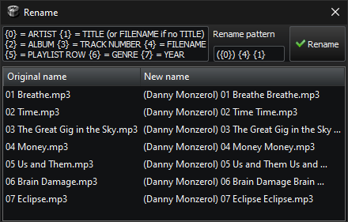

このダイアログでは、変数を含むパターンを使用して選択したファイルの名前を変更できます。
変数は次のとおりです：

{0} = アーティスト
{1} = タイトル (タイトルがない場合はファイル名)
{2} = アルバム
{3} = トラック番号
{4} = ファイル名
{5} = プレイリスト行番号
{6} = ジャンル
{7} = 年

\\ 文字を使用してディレクトリを作成することもできます。

例：{7} {2}\\{0} - {1}

出力：..\\1998 NYC Live\\Portishead - Sour Times.mp3

#### Lossless Edit
## ロスレス編集

   

ここでは選択したトラックの無音部分をカットしたり、音量を調整したりすることができます。その際、音質を損なうことはありません (ロスレス)。 

- **レベル**  
  ReplayGain と呼ばれる統計的解析手法を用いて、オーディオファイルの音量を調整し、すべてのファイルが特定のラウドネスで再生されるようにします (これは人間の耳にその曲が「実際に」どれほど大きく聞こえるかを反映したものです)。音量の調整は、mp3、m4a、および aac ファイルに対してのみ行うことができます。
  - **平均レベル** これはプログラムが達成しようと試みる目標ラウドネスです。
    デフォルト値は -16 LUFS です。
- **トリミング** 
  ファイルの先頭または末尾にある無音部分をすべて削除します。

ダイアログの下部にある**レベル/トリミング**チェックボックスをクリックすることで、すべてのレベル/トリミング チェックボックスのオン/オフを切り替えることができます。

#### DropZone
## ドロップゾーン

ドロップゾーンは、他のすべてのウィンドウの上に常に表示されるこの正方形の画像です。
ブラウザから YouTube の URL をドロップして、ブラウザを離れて KataLib に切り替えることなく KataLib で開くことができます。

**設定**の**表示**タブからサイズと透明度レベルを変更して、邪魔にならないようにできます。
右クリックで表示される[メニュー](#dropzone-menu)から利用できる便利なアクションもあります。

#### Visualization Video Setup
## ビジュアライゼーションビデオ設定

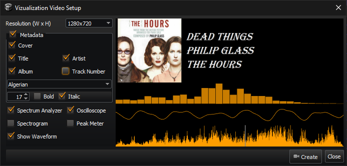

最初に選択できるのはビデオの解像度です。
含めたいメタデータとビデオに表示したいビジュアライゼーションウィジェットを選択することで、ビデオの表示内容をカスタマイズできます。
使用するフォントも選択できます。

変更を行うたびに、ダイアログの右側が更新され、ビデオのフレームがどのように見えるかが反映されます。
これは静的なプレビューであることに注意してください。ビデオではビジュアライゼーションウィジェットがトラックの音声に同期されます。

**作成**ボタンを押すと、ビデオファイルの場所と名前を尋ねられ、レンダリングが開始されます。

___

#### Context Menus
## コンテキストメニュー

#### Playlist Track
## プレイリストトラック

プレイリストトラックの右クリックメニューは、選択の種類に応じて異なるオプションがあります。
これらのオプションの一部は、一部のタイプのトラックでは利用できない場合があります。

| 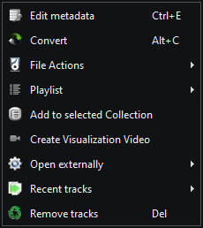 | 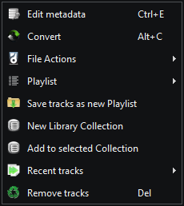 |             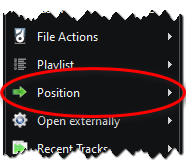             |
|:----------------------------------------------:|:------------------------------------------------:|:------------------------------------------------------------------------:|
|           _1つのファイルトラック選択_            |         _複数のファイルトラック選択_          | _1つのファイルトラック選択   (再生中または 保存位置あり)_ |

| 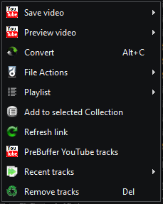 | 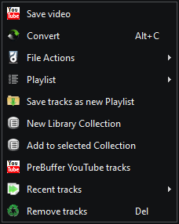 |
|:----------------------------------------------:|:------------------------------------------------:|
|       _1つのYouTubeリンクトラック選択_        |     _複数のYouTubeリンクトラック選択_      |

- **[メタデータ編集](#edit-metadata)**
- **ビデオを保存**
  - 1つの YouTube トラックのみが選択されている場合、ダウンロード可能なビデオファイル (ビデオと音声)を含むサブメニューが表示されます。
  - 複数の YouTube トラックが選択されている場合、各トラックの解像度を選択するための**解像度を選択**ウィンドウを開くオプションが表示されます。
- **ビデオをプレビュー**
  これは、プレビューとして使用できる YouTube トラックのビデオのみのストリームを含むサブメニューです。
  もちろん、元の音声をそれと一緒に使用することもできます。
  それらを結合して新しいビデオファイルとして保存することもできます。
- **[変換](#convert-dialog)**
- **[ファイルアクション](#ファイル)**
- **[プレイリスト](#playlist-menu)**
- **トラックを新しいプレイリストとして保存** および、複数のトラックが選択されている場合の**新しいライブラリコレクションの作成**。
- **選択したコレクションに追加**は、現在選択されているトラックを現在選択されているコレクションに追加します。
- **位置**は、トラックの現在位置を保存したり、以前に保存した位置から再生を開始したりできるサブメニューを開きます。
  - **現在の位置を保存**は、トラックの現在位置を、トラックのファイル名と同じ名前のファイルとしてディスクに保存します。
  - **保存した位置から再生**は、以前に保存した位置からトラックを再生し、関連ファイルが存在する場合にのみ有効です。
  - **保存した位置をクリア**は、保存位置ファイルが存在する場合に削除します。
- **[ビジュアライゼーションビデオを作成](#visualization-video-setup)** アクションは、ビジュアライゼーションウィジェットとトラックのメタデータの任意の組み合わせをトラックの音声とともに表示するビデオを作成するダイアログを開きます。このアクションは、単一のローカルファイルトラックが選択されている場合にのみ利用可能です。
- **外部で開く**
  選択したファイルトラックを4つのカスタムエディタのいずれかで開きます ([パス](#paths)を参照)。
- **YouTubeト ラックをプリバッファ**
  トラックの音声ストリームを即座にダウンロードして、アクティブなネット接続を必要とせずに再生/変換の準備を整えます。
- **リンクを更新**は、トラックの情報を YouTube から再度取得します。
- **最近のトラック**は、最近_再生_したトラックを再開できます。
- **トラックを削除**は、選択したトラックをプレイリストから削除するだけです。

#### Library Track
## ライブラリトラック

| 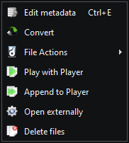 |
|:--------------------------------------------:|
|         _ライブラリトラック選択_          |

- **[メタデータ編集](#edit-metadata)**
- **[変換](#convert-dialog)**
- **[ファイルアクション](#ファイル)**
- **プレイヤーで再生**
  プレイリストをクリアし、選択したファイルを追加して最初のファイルの再生を開始します。
- **プレイヤーに追加**
  選択したファイルをプレイリストの末尾に追加します。
- **外部で開く**
  選択したファイルをシステムのプレイヤーで開きます。
- **ファイルを削除**
  選択したファイルをライブラリから<ins>_**およびディスクから**_</ins>削除します。

#### Library Collection
## ライブラリコレクション

| 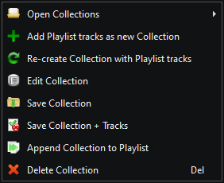 | 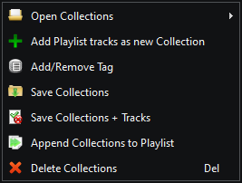 |
|:-----------------------------------------------:|:-------------------------------------------------:|
|        _1つのライブラリコレクション選択_        |      _複数のライブラリコレクション選択_      |

- **コレクションを開く** - 以下の2つのオプションのいずれかを選択します：
  - **ファイルからコレクションを開く** - `.dbc` コレクションファイルを開くか、`.lst` プレイリストファイルを新しいコレクションに変換します。
  - **YouTubeからプレイリストを開く** - YouTube プレイリストのアドレスからコレクションを作成します。
- **プレイリストトラックを新しいコレクションとして追加** - 現在読み込まれているプレイリストトラックから新しいコレクションを作成します。
- **プレイリストトラックでコレクションを再作成** - 現在選択されているコレクションのトラックを、現在読み込まれているプレイリストトラックで置き換えます。
- **コレクションを編集** - コレクションのタイトル、タグ、またはオンラインアドレスを変更するダイアログを開きます。
- **コレクションを保存** - コレクションを `.dbc` ファイルに保存します。
- **コレクション + トラックを保存** - コレクションを `.dbc` ファイルに保存し、コレクション名に "_tracks" サフィックスを付けた名前のフォルダーにコレクションのトラックファイルを作成します。
- **コレクションをプレイリストに追加** - コレクションのトラックを現在読み込まれているプレイリストに追加します。
- **コレクションを削除** - 選択したコレクションをライブラリから削除します。

#### Playlist menu
## プレイリストメニュー

|                プレイリストメニュー                |                    ソートリストメニュー                    |                    リストビューメニュー                    |
|:--------------------------------------------:|:----------------------------------------------------:|:----------------------------------------------------:|
| 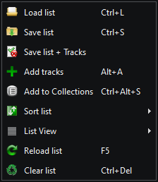 | 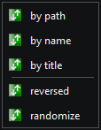 | 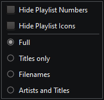 |

- **リストを読み込み**
    KataLib の `.lst` または WinAmp プレイリストファイルを開きます。
- **リストを保存**
    KataLib の `.lst` または WinAmp プレイリストファイルを保存します。
- **リスト + トラックを保存**
    KataLib の `.lst` または WinAmp プレイリストを保存し、プレイリスト名に "_tracks" サフィックスを付けた名前のフォルダーにリストのトラックファイルを作成します。
    プレイリストに YouTube リンクが含まれている場合、それらは現在の変換設定を使用して変換されます。
- **トラックを追加**
    プレイリストに追加するトラックの種類を選択するサブメニューを開きます。
  - ローカルファイルからのトラック (音声/ビデオメディアファイル)
  - YouTube リンクからのトラック (単一トラックまたはYouTubeプレイリスト)
- **コレクションに追加**
    現在のプレイリストを**[ライブラリコレクション](#library-collections)**にコレクションとして追加します。
- **リストをソート**
    **ソートリストメニュー**を開き、基本的なソートオプションを提供します。
- **リストビュー**
    **リストビューメニュー**を開き、プレイリストの番号とアイコンを切り替えたり、トラックの表示を変更したりできます。
- **リストを再読み込み**
    ローカルファイルをディスクから、YouTubeリンクをウェブから再読み込みします。
- **リストをクリア**
    プレイリストからすべてのトラックを削除します。

#### Cover menu
## カバーメニュー

これらのオプションは、選択の種類に応じて有効/無効になります。

  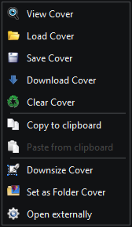

- **カバーを表示**
  カバー画像をフル解像度で表示するウィンドウを開きます (画面に収まる限り、そうでない場合は可能な限り大きく表示されます)。
- **カバーを読み込み**
  ファイルから画像をカバーとして読み込みます。
- **カバーを保存**
  カバーをディスク上の画像ファイルに保存します。
- **カバーをダウンロード**
  これは**カバーダウンロード**ダイアログを開き、指定したアーティスト、アルバムのエントリに基づいて画像を検索します。
- **カバーをクリア**
  選択したカバー画像をクリアします。
- **クリップボードにコピー**
  画像をシステムのクリップボードにコピーします。
- **クリップボードから貼り付け**
  システムのクリップボードに画像がある場合、カバーとして貼り付けられます。
- **カバーを縮小**
  **カバーダウンロード**ダイアログで指定されたサイズにカバー画像をリサイズします (カバー画像がより大きい場合のみ)。
- **フォルダーカバーに設定**
  カバーをトラックの親フォルダーの画像アイコンとして設定します (アルバムフォルダーに便利です)。
- **外部で開く**
  システムの画像ビューアでカバーを開きます。

#### Visualization menu
## ビジュアライゼーションメニュー

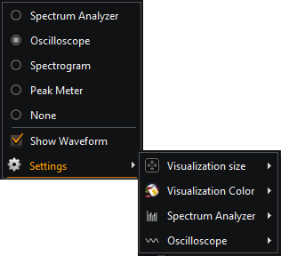

ここでは[ビジュアライザー](#visualizer)の4つのモードから選択します：

- **スペクトラムアナライザー**
- **オシロスコープ**
- **スペクトログラム**
- **ピークメーター**
- **なし** (ビジュアライゼーションを完全に非表示にします)。

[トランスポート](#transport)の位置バーの下に**波形を表示**する (またはしない)オプションもあります。

**設定**サブメニューには以下のオプションが含まれます：

- **ビジュアライゼーションの色**メニューでは、ビジュアライゼーションウィジェットの色をカスタマイズしたり、デフォルトに戻したりできます。
- **スペクトラムアナライザー**メニューでは、スペクトラムアナライザーをカスタマイズできます。3つのサブメニューがあります：
  - **バーの数**サブメニューでは、スペクトラムアナライザーで使用するバーの数を選択できます。デフォルトは 32ですが、24、32、40、48、56の間で値を選択できます。
  - **ピークホールド**サブメニューでは、スペクトラムアナライザーのピークホールドを有効/無効にできます。
  - **高さを最適化**サブメニューでは、高さの最適化を有効/無効にできます。つまり、トラックの波形の高さに関係なく、バーの高さが最大レベルに正規化されるかどうかです。
- **オシロスコープ**メニューには、**ズームレベル**サブメニューがあり、サンプルウィンドウの異なるズームレベルから選択できます：
  - 低ズーム
  - 標準ズーム
  - 高ズーム

#### Compact View menu
## コンパクトビューメニュー

[コンパクトビュー](#compact-view)のカバーアートを右クリックすると、このメニューが表示されます。

| 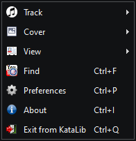 | 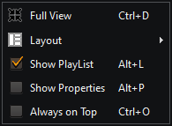 |
|:------------------------------------------:|:--------------------------------------------------:|
|          _コンパクトビューメインメニュー_          |                    _ビューメニュー_                     |

- **トラック**は、選択したトラックの[プレイリストメニュー](#playlist-menu)を開きます。
- **カバー**は、表示されているカバーアートの[カバーアートメニュー](#cover-menu)を開きます。
- **表示**
  以下の内容を含むビューメニューを表示します。
    - **フルビュー** - 表示モードをフルに切り替え
    - **レイアウト**サブメニューには、すべてのコンパクトビューウィンドウの現在のレイアウトを保存および復元するオプションがあります。
    - **プレイリストを表示**ウィンドウの切り替えスイッチ
    - **プロパティを表示**ウィンドウの切り替えスイッチ
    - すべてのコンパクトビューウィンドウの**常に手前に表示**モードの切り替えスイッチ
- **検索**は[検索](#find)ダイアログを開きます。
- **設定**は[設定](#preferences)ダイアログを開きます。
- **このアプリについて**は[このアプリについて](#about)ダイアログを開きます。
- **KataLib を終了**はアプリケーションを終了します。

#### DropZone menu
## ドロップゾーンメニュー

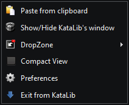

これはドロップゾーンを右クリックしたときに表示されるメニューです。

- **クリップボードから貼り付け**は、システムのクリップボードからYouTubeのURLを検索し、KataLib に追加します。
- **KataLib ウィンドウを表示/非表示**は、アプリを閉じずに他のすべてのウィンドウを (タスクバーからも)完全に非表示にできます。
- **ドロップゾーン**は、ドロップゾーンのサイズを変更したり完全に非表示にしたりできるサブメニューです。
- **コンパクトビュー**は、アプリの通常ビューとコンパクトビューを切り替えます。
- **設定**はアプリの設定へのショートカットです。
- **KataLibを終了**はアプリケーションを終了します。

___

#### Shortcuts
## ショートカット

| **全般**               　           |           |
|-------------------------------------|-----------|
| コンパクトビューを切り替え          | Ctrl+D    |
| 変換                                | Alt+C     |
| ファイル (コピー)                   | Alt+V     |
| メタデータ編集                      | Ctrl+E    |
| 削除/削除                           | Del       |
| ディスクから削除                    | Shift+Del |
| ライブラリ/コレクションをフィルター | Alt+F     |
| ライブラリフォルダー                | Ctrl+M    |
| 設定                                | Ctrl+P    |
| このアプリについて/情報             | Ctrl+I    |
| KataLib を終了                      | Ctrl+Q    |

| **コンパクトモード** 固有    |        |
|------------------------------|--------|
| プレイリストパネルを切り替え | Alt+L  |
| プロパティパネルを切り替え   | Alt+P  |
| 常に手前に表示を切り替え     | Ctrl+O |

| **プレイヤー**              |                                          |
|-----------------------------|------------------------------------------|
| 再生/一時停止               | スペース                                 |
| 停止                        | Ctrl+スペース                            |
| フェードアウトして停止      | Ctrl+Alt+スペース                        |
| トラック終了時に停止        | Shift+スペース                           |
| シーク (位置バー)           | 左/右 ↔                                  |
| 次を再生                    | Ctrl+右 →                               |
| 前を再生                    | Ctrl+左 ←                               |
| クロスフェードで次を再生    | Alt+右 →                                |
| 音量                        | 上/下 ↑↓                               |
| ミュート                    | Alt+M                                    |
| タップテンポ                | Alt+T                                    |
| 次を選択                    | Ctrl+下 ↓                               |
| 前を選択                    | Ctrl+上 ↑                               |
| トラックの位置を保存        | Ctrl+ピリオド                            |
| 保存位置から再生            | Alt+ピリオド                             |
| プレイヤー速度を 0.1下げ    | [ または / (Shiftでセント単位、Altで1.0) |
| プレイヤー速度を 0.1上げ    | ] または * (Shiftでセント単位、Altで1.0) |
| プレイヤーピッチを半音下げ  | - または _ (Shiftでセント単位、Altで0.0) |
| プレイヤーピッチを半音上げ  | = または + (Shiftでセント単位、Altで0.0) |

| **プレイリスト**                     |               |
|--------------------------------------|---------------|
| プレイリストを読み込み               | Ctrl+L        |
| プレイリストを保存                   | Ctrl+S        |
| プレイリストをクリア                 | Ctrl+Del      |
| プレイリストを再読み込み             | F5            |
| プレイリストをコレクションとして追加 | Ctrl+Alt+S    |
| トラックを検索                       | Ctrl+F        |
| トラックを追加 (ローカルファイル)    | Alt+A         |
| トラックを削除                       | Del           |
| トラックを削除                       | Shift+Del     |
| すべて繰り返し                       | Alt+R         |
| シャッフル                           | Alt+S         |
| DJ 表示/非表示                       | Alt+D         |
| プレビュー 表示/非表示               | Ctrl+スペース |

| **ファイル操作** |           |
|------------------|-----------|
| ファイルコピー   | Alt+V     |
| ファイルの移動   | Alt+B     |
| ファイル名の変更 | Alt+N     |
| ロスレス編集     | Alt+E     |
| ファイルの削除   | Shift+Del |

**ホットキー (グローバルショートカット)**

これらはデフォルトで無効になっています。
有効にするには `設定 > 詳細設定 > グローバルホットキーを使用` に移動してください。
これらのデフォルトの割り当てはユーザーが変更できます。

| ショートカット        | ホットキー |
|-----------------------|------------|
| 再生/一時停止         | Win+Ctrl+Z |
| 停止                  | Win+Ctrl+C |
| 前へ                  | Win+Ctrl+A |
| 次へ                  | Win+Ctrl+X |
| 右にシーク            | Win+Ctrl+] |
| 左にシーク            | Win+Ctrl+[ |
| クロスフェードを開始  | Win+Ctrl+W |
| 表示/非表示           | Win+Ctrl+S |
| 音量を上げる          | Win+.      |
| 音量を下げる          | Win+,      |
